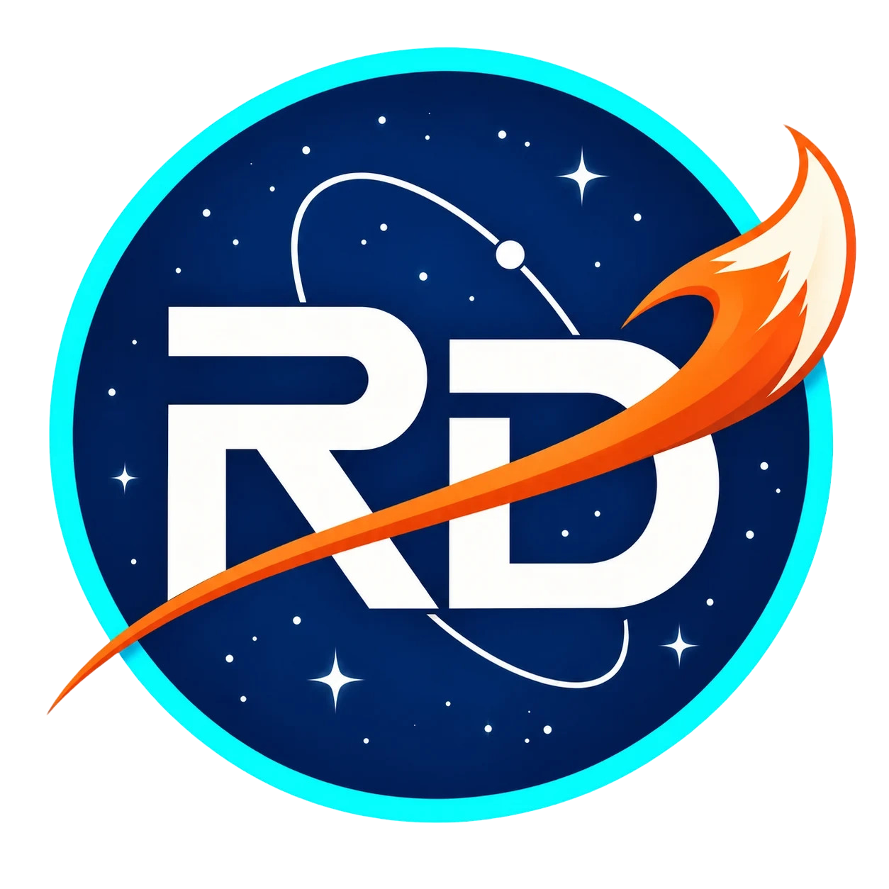

  

<h1 align="center">RSL Drafter</h1>

  <a href="https://rsldrafter.app">Website</a> ·
  <a href="https://rsldrafter.app/beta-account">Beta account</a> ·
  <a href="https://discord.gg/aTnw69gnHc">Discord community</a>

RSL Drafter is a Windows bot for RAID: Shadow Legends Live Arena. It runs a Preset Lineup that you configure: five champion slots, ordered substitutes, draft priorities and supported Battle Openers. You review the setup and explicitly start each bounded session.

This repository provides product information and release downloads. The application source code is not published here.

## Public beta

- **Current build:** [RSL Drafter 0.1.5](https://github.com/Nanaconda38/RSL-Drafter/releases/tag/v0.1.5)
- **Platform:** Windows 11 x64
- **Supported game build:** RAID: Shadow Legends 11.85.5
- **Download:** Public on the [latest GitHub Releases page](https://github.com/Nanaconda38/RSL-Drafter/releases/latest).
- **App access:** Downloads are public; using the app requires an active beta access grant. Create an account at the [beta account page](https://rsldrafter.app/beta-account), verify the one confirmation email, then sign in to that page. While enrollment is open, the beta API creates a grant only when its checks pass. Account registration or email verification alone does not grant access; the API is authoritative.

## What the bot does

1. **Build a five-champion lineup.** Choose a primary for each slot, order substitutes and link fallback slots.
2. **Set draft priorities.** Configure Pick Rules, ban priorities, leader order and supported Battle Openers.
3. **Run a bounded Live Arena session.** Review the plan and session limits, connect to RAID, then explicitly start.

The current public release supports **Preset Lineup for Live Arena only**. Adaptive Draft and Classic Arena are not available. RSL Drafter does not promise a win or choose a meta team for you.

## Download and get started

1. Open the [latest GitHub release](https://github.com/Nanaconda38/RSL-Drafter/releases/latest), read the release notes, and use `RSL-Drafter-Setup-v0.1.5.exe` for a first installation.
2. [Create an account or sign in](https://rsldrafter.app/beta-account) on the site account page.
3. For a new account, complete the hosted sign-up and verify the one confirmation email. Sign in to the site account page; while enrollment is open, the API automatically creates an access grant when its checks pass. If enrollment is paused, no new grant is created until it reopens.
4. Open RSL Drafter and choose **Sign in**. The app opens the secure browser sign-in page; enter your username or email and password there, never in the desktop app.
5. Return to the app, launch RAID if needed, connect, review your Preset Lineup and session limits, then explicitly start Live Arena.

**Requirements:** Windows 11 x64, RAID: Shadow Legends 11.85.5 through the standard Plarium Play installation, administrator permission, and internet access for the startup version check and account sign-in. The installer bundles the .NET 8 and WPF runtimes; no separate runtime or developer tools are needed. The installed application is `RSL-Drafter.exe`; the separate updater is `RSL-Drafter.Updater.exe`. Legacy ArenaDrafter names remain in compatibility files for older update paths. The version-matched `RSL-Drafter-Update-v0.1.5.zip` and `update-manifest.json` are for the in-app updater, not first installation.

[Open the illustrated setup guide](https://rsldrafter.app/beta-get-started).

Never share your password or confirmation link. Previously issued verification, invitation and withdrawal links may remain usable until they expire.

## Data and updates

The standard Release in public build 0.1.5 enables anonymous V3 and optional pseudonymous V1 match-sharing paths. Anonymous-only is the default choice, but collection starts only after you review and save the in-app notice. Account-linked sharing is a separate explicit choice bound to the signed-in beta account; the match JSON omits direct account identifiers. Turn sharing off in Settings to stop future collection/uploads and delete pending local records; records already accepted by the service are not removed by opting out.

Only complete, played Live Arena matches with an explicit Victory or Defeat are eligible. Match records contain observed draft facts, champion Base IDs, bans and leaders, result/quality categories, coarse points ranges (general points in 50-point buckets and seasonal points in 10-point buckets when available), and app/RAID/collector/catalog version metadata. They exclude player/opponent names and account IDs, device identifiers, exact points, roster/equipment inventories, screenshots, logs and raw game memory. See the [data notice](https://rsldrafter.app/data-notice) for the consent, field, network and retention details, and [TELEMETRY.md](TELEMETRY.md) for the technical inventory.

Pending match JSON is stored locally for up to 30 days, with a shared limit of 500 files or 50 MiB. The production service is configured to expire accepted raw match records after two calendar years; elapsed expiry has not been independently verified. An authenticated live-match receipt and retrieval have not yet been verified, so an upload attempt or local receipt counter is not proof of durable server storage.

The app checks GitHub for the latest release at every launch before sign-in. A newer version must be installed to continue; if the latest-version check is unavailable or invalid, sign-in remains blocked until the check can be retried. The app asks before downloading an update. GitHub receives the connection information needed for the startup check and any download; server-side logging and retention are not verified by RSL Drafter.

The public website does not use analytics. Account sign-in, beta access checks, release checks and downloads are separate from match records.

## Reporting a problem

Before opening an issue, check the release notes and existing issues. Include:

- RSL Drafter version;
- RAID build;
- what you were doing;
- what you expected and what happened.

Do not post passwords, tokens, account details or unreviewed diagnostic files. Review any diagnostic report before attaching it.

[Open an issue](https://github.com/Nanaconda38/RSL-Drafter/issues)

## Disclaimer

RSL Drafter is an independent community project. It is not affiliated with, endorsed by or sponsored by Plarium. RAID: Shadow Legends and related marks belong to their respective owners.

## License

All rights reserved. See [LICENSE](LICENSE). No open-source license is granted for this repository or the application releases.
